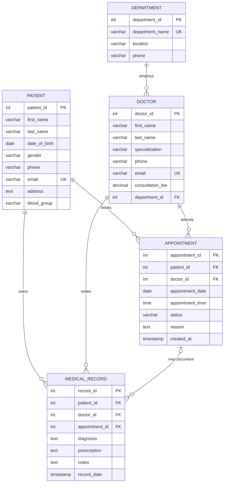

# Hospital Management System

A complete, beginner-friendly **Hospital Management System (HMS)** rebuilt from the original DBMS project report. It manages **departments, doctors, patients, appointments, and medical records** with a normalised MySQL database, a small Express REST API, and a responsive HTML/CSS/JavaScript interface.

> **Original project:** “Hospital Management” DBMS report by Mohammed Farhan (1MS24CS100), Manoj H V (1MS24CS094), and K S Tanish (1MS24CS074), Department of CSE, Ramaiah Institute of Technology.
>
> The report's database design, table structures, constraints, normalisation, and business rules are the primary source for this implementation. Implementation choices made where the report was silent are listed in [Design decisions](#design-decisions).

---

## 1. Tech stack

| Layer | Technology | Why |
|---|---|---|
| Frontend | HTML, CSS, vanilla JavaScript | Requested by the user; no build step and easy to read/modify |
| Backend | Node.js + Express | The report used Node/Express; JavaScript is used on both sides; minimal setup |
| Database driver | `mysql2` with a connection pool | Parameterised SQL, promises, and efficient connection reuse |
| Database | MySQL 8.0+ (MariaDB 10.4+ also works) | Relational database specified by the report |
| Config | `dotenv` | Keeps database credentials out of source code |

The Express server also serves the frontend, so the browser, API, and database all use **one origin**: `http://localhost:3000`. This avoids CORS configuration and means the project runs with one command.

### Architecture

```
┌─────────────────────────────────────────────────────────────┐
│ Browser                                                     │
│  frontend/index.html + css/style.css + js/script.js         │
│  - sidebar navigation, tables, forms, fetch() calls        │
└──────────────────────────┬──────────────────────────────────┘
                           │  JSON over HTTP (/api/...)
                           ▼
┌─────────────────────────────────────────────────────────────┐
│ Express server (backend/server.js)                          │
│  routes/departments.js   routes/doctors.js                  │
│  routes/patients.js      routes/appointments.js             │
│  routes/medicalRecords.js routes/dashboard.js               │
│  validation.js · errorHandler.js · asyncHandler.js          │
└──────────────────────────┬──────────────────────────────────┘
                           │  parameterised SQL (mysql2 pool)
                           ▼
┌─────────────────────────────────────────────────────────────┐
│ MySQL database: hospital_management                         │
│  department · doctor · patient · appointment · medical_record│
└─────────────────────────────────────────────────────────────┘
```

---

## 2. Features

- **Dashboard** — total departments, doctors, patients, today's appointments, medical records, today's schedule, and recent diagnoses.
- **Departments** — list, add, edit, delete; shows the number of doctors in each department; deletion is blocked while doctors are assigned.
- **Doctors** — list, add, edit, delete; each doctor is assigned to a department; unique email; consultation fee validation.
- **Patients** — list, add, edit, delete; date of birth, gender, optional unique email, address, and blood group validation.
- **Appointments** — list, book, edit, mark completed, cancel, delete; joins patient and doctor names; **prevents the same doctor from being booked at the same date and time**.
- **Medical Records** — list and add; optional link to a completed appointment; diagnosis required; prescription and notes optional.
- **Data integrity** — primary keys, foreign keys, unique keys, `CHECK` constraints, cascade/restrict rules, and parameterised queries.
- **Responsive UI** — desktop sidebar, mobile off-canvas menu, scrollable tables, accessible forms, confirmation dialogs, and toast messages.

---

## 3. Project structure

```
hospital-management-system/
├── frontend/
│   ├── index.html              # All pages/sections in one HTML document
│   ├── css/
│   │   └── style.css           # Design system, layout, responsive rules
│   └── js/
│       └── script.js           # Navigation, fetch calls, tables, forms
│
├── backend/
│   ├── server.js               # Express app + static frontend
│   ├── package.json
│   ├── package-lock.json
│   ├── .env.example            # Copy to .env and edit
│   ├── .gitignore
│   ├── config/
│   │   └── database.js         # mysql2 connection pool + findById helper
│   ├── middleware/
│   │   └── errorHandler.js     # Friendly MySQL error messages
│   ├── routes/
│   │   ├── dashboard.js
│   │   ├── departments.js
│   │   ├── doctors.js
│   │   ├── patients.js
│   │   ├── appointments.js
│   │   └── medicalRecords.js
│   └── utils/
│       ├── asyncHandler.js
│       ├── errors.js
│       └── validation.js
│
├── database/
│   ├── hospital_management.sql # Database, tables, indexes, sample data
│   └── queries.sql             # SELECT / JOIN / INSERT / UPDATE / DELETE examples
│
└── README.md
```

The extra backend folders are a small, conventional split of the report's router code. The frontend remains the simple three-file structure requested.

---

## 4. Database design

### 4.1 Entity-relationship model



### 4.2 Tables and constraints

| Table | Primary key | Important constraints |
|---|---|---|
| `department` | `department_id` | `department_name` `NOT NULL UNIQUE`; location and phone `NOT NULL` |
| `doctor` | `doctor_id` | `email NOT NULL UNIQUE`; `consultation_fee >= 0`; FK `department_id` → `department` `ON DELETE RESTRICT` |
| `patient` | `patient_id` | `gender IN ('Male','Female','Other')`; `email UNIQUE` nullable; `blood_group` limited to the 8 valid groups |
| `appointment` | `appointment_id` | `status IN ('Scheduled','Completed','Cancelled')`; `UNIQUE (doctor_id, appointment_date, appointment_time)`; patient/doctor FKs `ON DELETE CASCADE`; `reason NOT NULL` |
| `medical_record` | `record_id` | diagnosis `NOT NULL`; patient/doctor FKs `ON DELETE CASCADE`; appointment FK `ON DELETE SET NULL` |

**Indexes** (from the report): `doctor.department_id`, `appointment.patient_id`, `appointment.doctor_id`, `appointment.appointment_date`, `medical_record.patient_id`, `medical_record.doctor_id`, `medical_record.appointment_id`.

### 4.3 Why the design is in 3NF

- **1NF:** Every column stores one atomic value and every table has a primary key. There are no repeating groups such as “doctor1, doctor2” in a single cell.
- **2NF:** Every table uses a single-column auto-increment primary key, so all non-key columns depend on the whole key. For example, a patient's name is stored only in `patient`, and `appointment` stores only `patient_id`.
- **3NF:** There are no transitive dependencies. A doctor has a `department_id`, but department name/location/phone live only in `department`. If a department moves, one row is updated instead of every appointment. Age is **calculated in the UI** from `date_of_birth`, not stored and duplicated.

### 4.4 Referential-integrity rules

| Rule | Behaviour | Why |
|---|---|---|
| Delete a department with doctors | **Blocked** (`ON DELETE RESTRICT`) | Prevents doctors from pointing to a missing department |
| Delete a patient | Their appointments and medical records are deleted (`CASCADE`) | Report requirement; no orphan records |
| Delete a doctor | Their appointments and medical records are deleted (`CASCADE`) | Same principle |
| Delete an appointment | Linked medical record is kept; `appointment_id` becomes `NULL` (`SET NULL`) | Clinical history is not lost just because the booking is removed |
| Book the same doctor twice at one date/time | **Blocked** by the composite unique key | Report's scheduling rule |

The application additionally refuses to link a medical record to anything other than a **completed** appointment that belongs to the same patient and doctor. The report states this business rule, but the schema alone cannot express a cross-table status condition, so it is enforced in `backend/routes/medicalRecords.js`.

---

## 5. Setup instructions

### 5.1 Prerequisites

Install these first:

1. **Node.js 18 LTS or newer** — <https://nodejs.org>
   ```bash
   node -v
   npm -v
   ```
2. **MySQL 8.0+** (or MariaDB 10.4+) — <https://dev.mysql.com/downloads/mysql/>
   - During installation, remember the **root password**.
   - Make sure the MySQL service is running.
   - On Windows: open **Services** and check `MySQL80` (or similar) is running.
3. Optional: **MySQL Workbench** for importing/running SQL visually.
4. A modern browser (Chrome, Edge, Firefox, Safari).

### 5.2 Import the database

The script creates the database, all five tables, indexes, and realistic sample data.

> **Warning:** `hospital_management.sql` begins with `DROP DATABASE IF EXISTS hospital_management;`. This gives a clean import every time, but it deletes an existing `hospital_management` database. Do not run it against data you want to keep.

#### Option A — MySQL Workbench (easiest)

1. Open MySQL Workbench and connect to your local MySQL server.
2. Choose **File → Open SQL Script…** and select `database/hospital_management.sql`.
3. Click the **Execute** button (lightning icon).
4. Refresh the **Schemas** panel. You should see `hospital_management` with five tables.

#### Option B — Command line (Windows CMD / macOS / Linux)

From the `hospital-management-system` folder:

```bash
mysql -u root -p < database/hospital_management.sql
```

Windows **PowerShell** does not support `<` redirection the same way. Use:

```powershell
cmd /c "mysql -u root -p < database\hospital_management.sql"
```

Or use the MySQL client's `SOURCE` command with the full path:

```powershell
mysql -u root -p -e "SOURCE C:/path/to/hospital-management-system/database/hospital_management.sql"
```

#### Verify the import

```bash
mysql -u root -p -e "USE hospital_management; SHOW TABLES; SELECT COUNT(*) AS doctors FROM doctor;"
```

Expected tables:

```
appointment
department
doctor
medical_record
patient
```

Expected seed counts: **6 departments, 8 doctors, 10 patients, 12 appointments, 6 medical records**.

#### Run the demonstration queries (optional)

```bash
mysql -u root -p hospital_management < database/queries.sql
```

`queries.sql` includes SELECT, JOIN, INSERT, UPDATE, and DELETE examples. Destructive DML examples are wrapped in transactions and rolled back, so the sample data stays intact. It also contains integrity checks and a commented-out duplicate-booking demonstration.

### 5.3 Configure the backend

Open a terminal in the project folder:

```bash
cd hospital-management-system/backend
```

Create your local environment file:

**Windows:**

```powershell
copy .env.example .env
```

**macOS/Linux:**

```bash
cp .env.example .env
```

Open `backend/.env` and edit it:

```ini
DB_HOST=localhost
DB_PORT=3306
DB_USER=root
DB_PASSWORD=your_mysql_password
DB_NAME=hospital_management
PORT=3000
```

- If your MySQL root account has **no password**, leave `DB_PASSWORD=` empty.
- If you use a different MySQL port, change `DB_PORT`.
- `.env` is ignored by Git and must never be committed.

### 5.4 Install and run

From the `backend` folder:

```bash
npm install
npm start
```

You should see:

```
Connected to MySQL database successfully.
Hospital Management System is running at http://localhost:3000
```

Open **<http://localhost:3000>** in your browser.

For development, `npm run dev` restarts the server when files change (Node 18+).

Stop the server with `Ctrl+C`.

### 5.5 Reset the project

To start fresh, re-import `database/hospital_management.sql`. It drops and recreates the database with clean sample data.

---

## 6. Sample data

| Departments | Doctors | Patients | Appointments | Records |
|---|---|---|---|---|
| Cardiology, Neurology, Orthopedics, Pediatrics, Dermatology, General Medicine | 8 profiles across the departments | 10 patients with varied blood groups/contact details | 12 appointments (past, today, upcoming, completed, cancelled) | 6 records, including one standalone record with no appointment |

Appointment dates use `CURDATE()` and `INTERVAL` expressions so the dashboard has today/upcoming data whenever you import the script.

---

## 7. API reference

Base URL: `http://localhost:3000/api`

| Method | Endpoint | Purpose |
|---|---|---|
| GET | `/health` | Check that MySQL is reachable |
| GET | `/dashboard` | Counts, today's schedule, recent records |
| GET | `/departments` | List departments with doctor counts |
| GET | `/departments/:id` | One department |
| POST | `/departments` | Create department |
| PUT | `/departments/:id` | Update department |
| DELETE | `/departments/:id` | Delete department (blocked if doctors exist) |
| GET | `/doctors` | List doctors with department names |
| GET | `/doctors/:id` | One doctor |
| POST | `/doctors` | Create doctor |
| PUT | `/doctors/:id` | Update doctor |
| DELETE | `/doctors/:id` | Delete doctor and cascade related rows |
| GET | `/patients` | List patients |
| GET | `/patients/:id` | One patient |
| POST | `/patients` | Create patient |
| PUT | `/patients/:id` | Update patient |
| DELETE | `/patients/:id` | Delete patient and cascade related rows |
| GET | `/appointments` | List appointments with patient/doctor names |
| GET | `/appointments/:id` | One appointment |
| POST | `/appointments` | Book appointment (duplicate slot check) |
| PUT | `/appointments/:id` | Update appointment |
| PATCH | `/appointments/:id/status` | Change status to Scheduled/Completed/Cancelled |
| DELETE | `/appointments/:id` | Delete appointment |
| GET | `/medical-records` | List records with patient/doctor/appointment details |
| GET | `/medical-records/:id` | One record |
| POST | `/medical-records` | Add record; appointment optional but must be completed and match |

All values are sent as JSON. Errors look like:

```json
{ "error": "This doctor already has an appointment at the selected date and time. Please choose another slot." }
```

Medical records are intentionally **append-only** in this version (view + add), matching the report's “archive clinical data” description and the requested feature list. There is no `PUT`/`DELETE` route for records.

---

## 8. Important SQL queries

The complete set is in `database/queries.sql`. The most important patterns:

### Appointment list with names (used by the API)

```sql
SELECT a.appointment_id, a.appointment_date, a.appointment_time, a.status,
       a.reason,
       CONCAT(p.first_name, ' ', p.last_name) AS patient_name,
       CONCAT(d.first_name, ' ', d.last_name) AS doctor_name,
       d.specialization
FROM appointment a
JOIN patient p ON a.patient_id = p.patient_id
JOIN doctor  d ON a.doctor_id  = d.doctor_id
ORDER BY a.appointment_date DESC, a.appointment_time DESC;
```

### Doctors in each department (includes empty departments)

```sql
SELECT dep.department_name, COUNT(d.doctor_id) AS doctor_count
FROM department dep
LEFT JOIN doctor d ON dep.department_id = d.department_id
GROUP BY dep.department_id, dep.department_name;
```

### Complete medical history for one patient

```sql
SELECT mr.record_date, mr.diagnosis, mr.prescription, mr.notes,
       CONCAT(d.first_name, ' ', d.last_name) AS doctor_name
FROM medical_record mr
JOIN doctor d ON mr.doctor_id = d.doctor_id
WHERE mr.patient_id = 2
ORDER BY mr.record_date DESC;
```

### Double-booking check

```sql
SELECT doctor_id, appointment_date, appointment_time, COUNT(*) AS bookings
FROM appointment
GROUP BY doctor_id, appointment_date, appointment_time
HAVING COUNT(*) > 1;
```

This should return **zero rows**; the database's `UNIQUE (doctor_id, appointment_date, appointment_time)` prevents conflicts.

### Parameterised inserts used by the backend

```js
await pool.query(
  `INSERT INTO appointment
     (patient_id, doctor_id, appointment_date, appointment_time, status, reason)
   VALUES (?, ?, ?, ?, ?, ?)`,
  [patientId, doctorId, date, time, status, reason]
);
```

`?` placeholders let `mysql2` escape values, preventing SQL injection.

---

## 9. How each major feature works

### Department management
The Departments page calls `GET /api/departments`, which uses a `LEFT JOIN` to count doctors per department. Add/edit forms send JSON to `POST`/`PUT`; the backend trims and validates fields before using parameterised SQL. Delete calls `DELETE`, and MySQL's `ON DELETE RESTRICT` returns error 1451 if doctors still exist; the error handler converts that into a readable message.

### Doctor management
The form loads departments first so a doctor can only be assigned to a real department. The email must be unique; duplicate emails produce MySQL error 1062, which the central error handler converts to “That email address is already registered.” Deleting a doctor cascades to their appointments and records (as the report requires), so the UI warns the user first.

### Patient management
Patients validate date of birth, gender, phone, address, and blood group. An empty email is converted to `NULL`, because MySQL allows multiple `NULL` values in a `UNIQUE` column but would reject multiple empty strings. Age is calculated in the browser from the stored date.

### Appointment scheduling
Booking sends patient, doctor, date, time, status, and reason. Before inserting, the API checks that both people exist and that the doctor is free at that exact date/time. The database's composite unique constraint is the final guard. On success, the list reloads and shows joined names. The Complete/Cancel buttons use `PATCH /api/appointments/:id/status`; deleting removes the row and leaves any medical record with a `NULL` appointment link.

> **Note:** because the report's unique constraint is on `(doctor_id, date, time)` and does not include `status`, a **cancelled** appointment still occupies its slot until it is deleted or edited. This is faithful to the report.

### Medical records
The form fetches completed appointments. Choosing one automatically fills the patient and doctor. The API then verifies:
1. the patient and doctor exist,
2. the appointment exists,
3. its status is `Completed`,
4. its patient/doctor match the selected ones.

Only then is the record inserted. Deleting the linked appointment later sets `appointment_id` to `NULL` but keeps the diagnosis, prescription, and notes.

---

## 10. Testing performed

This project was tested against a temporary **MariaDB 11.4** instance (MySQL-compatible):

- Imported `hospital_management.sql` successfully; verified **6/8/10/12/6** seed row counts.
- Ran `queries.sql` successfully, including all JOINs, transactions, and integrity checks.
- Executed **74 API checks** covering:
  - static file serving and JSON 404s,
  - full CRUD for departments, doctors, patients, and appointments,
  - duplicate email rejection,
  - negative fee / invalid gender / invalid blood group / invalid date rejection,
  - duplicate doctor-slot rejection (HTTP 409),
  - appointment status updates,
  - medical-record completed-appointment and patient/doctor-match rules,
  - preventing a linked appointment from being reassigned or moved out of `Completed`,
  - `ON DELETE SET NULL` for appointment deletion,
  - `ON DELETE CASCADE` for patient deletion,
  - department deletion restricted while doctors exist.
- Tested the actual browser UI: navigation, add/edit/delete on every page, duplicate-slot error shown inside the form, appointment complete/cancel, medical-record auto-fill, toast messages, and cascade cleanup.
- Verified `node --check` on every JavaScript file.

To repeat the important checks manually:

1. Import the SQL script and start the server.
2. Open the Dashboard and confirm the counts.
3. Add a department, doctor, and patient.
4. Book an appointment and try to book the **same doctor/date/time** again — the form should show an error.
5. Mark the appointment Completed, then add a medical record linked to it.
6. Try deleting a department that still has doctors — it should be refused.
7. Delete a test patient — their appointments and records should disappear.
8. Run `database/queries.sql` to verify joins and integrity checks.

---

## 11. Design decisions

The report is the primary source. Where it was silent, these choices were made:

| Area | Decision | Reason |
|---|---|---|
| Frontend | Vanilla HTML/CSS/JS instead of the report's React/Vite | Explicit user requirement; no build step |
| Backend | Express + `mysql2` | Report's own architecture; simple for a beginner |
| `appointment.reason` | `NOT NULL` | Data Directory says `NOT NULL`; the pasted source snippet omitted it |
| Medical-record appointment | Must be `Completed` and belong to the same patient/doctor | Report's functional requirement; enforced in the API because SQL `CHECK` cannot reference another table |
| Medical records | View + add only | Requested feature list; report describes records as archived history |
| Linked appointment lock | Once a record is attached, patient/doctor and `Completed` status cannot be changed | Keeps the clinical record consistent with its appointment |
| Cancelled appointments | Still reserve the unique slot | The report's constraint does not include status |
| Record uniqueness per appointment | Not enforced | The report does not specify a unique constraint on `medical_record.appointment_id` |
| Sample dates | Relative to `CURDATE()` | Keeps the dashboard useful after any import |
| Currency display | Indian rupee (₹) | Report is from an Indian institution; only a display choice |
| Authentication / billing / pharmacy | Not implemented | Outside the five modules in the report's scope |
| `DROP DATABASE` in script | Included | Makes repeated classroom/demo imports clean; clearly warned |

---

## 12. Troubleshooting

| Problem | Cause / fix |
|---|---|
| `Could not connect to MySQL` | MySQL service is stopped, or `.env` credentials are wrong |
| `ECONNREFUSED 127.0.0.1:3306` | Start the MySQL service or correct `DB_PORT` |
| `ER_ACCESS_DENIED_ERROR` | Wrong `DB_USER`/`DB_PASSWORD`; test with `mysql -u root -p` |
| `ER_BAD_DB_ERROR: Unknown database` | Import `hospital_management.sql` first |
| `EADDRINUSE: address already in use` | Another program uses port 3000; change `PORT` in `.env` |
| `Cannot find module 'express'` | Run `npm install` inside `backend`, not the project root |
| Browser shows “Could not load data” | Backend is not running, or you opened `frontend/index.html` directly. Use `http://localhost:3000` |
| Department delete fails | Expected: doctors are still assigned. Reassign/delete the doctors first |
| Duplicate appointment error | Expected: that doctor already has a booking at the exact date/time |
| SQL import fails in PowerShell | Use `cmd /c "mysql -u root -p < database\hospital_management.sql"` or MySQL Workbench |
| Tables show `?`/mojibake for accents | Import with `--default-character-set=utf8mb4`; the schema uses `utf8mb4` |

---

## 13. Interview preparation

### Q1. What does this project do?
It digitises five hospital workflows: departments, doctors, patients, appointments, and medical records. The browser calls an Express REST API, which runs parameterised SQL against a normalised MySQL database.

### Q2. Why is the database in 3NF?
Each table has a single-column primary key (2NF), stores only atomic values (1NF), and keeps dependent data in its own table. Department details are not repeated in `doctor`; only `department_id` is stored. That removes transitive dependencies and update anomalies.

### Q3. How do you prevent double-booking?
With `UNIQUE (doctor_id, appointment_date, appointment_time)` on `appointment`. The API also checks before inserting to produce a friendly message, but the database constraint is the final authority.

### Q4. Why a composite unique key instead of making `appointment_id` unique?
`appointment_id` is already the primary key. The business rule is about a *combination* of doctor, date, and time, so the uniqueness must span those three columns.

### Q5. What is the difference between a primary key and a foreign key?
A primary key uniquely identifies a row in its own table. A foreign key is a column that references a primary key in another table, enforcing referential integrity.

### Q6. Why different `ON DELETE` rules?
- `RESTRICT` on doctor→department prevents a department from disappearing while doctors still reference it.
- `CASCADE` on patient/doctor→appointment/record matches the report: removing a person removes their related clinical rows.
- `SET NULL` on appointment→record preserves medical history when only the booking is deleted.

### Q7. How does the app prevent SQL injection?
Every user value is passed through `?` placeholders to `mysql2`. The driver escapes the value; SQL text and data are never concatenated. Dynamic table names in the internal `findById` helper come only from server code, never from the browser.

### Q8. Why use a connection pool?
Opening a new MySQL connection per request is slow. `mysql2`'s pool keeps a small set of reusable connections and queues requests when all are busy.

### Q9. How are duplicate emails handled?
`doctor.email` and `patient.email` are `UNIQUE`. MySQL raises error 1062; `middleware/errorHandler.js` detects the duplicate key and returns HTTP 409 with a readable message that the form displays.

### Q10. Why can a medical record only link to a completed appointment?
The report says records are generated after a completed visit. A database `CHECK` cannot inspect another table's `status`, so the API validates it before inserting.

### Q11. What happens when a patient is deleted?
The `ON DELETE CASCADE` foreign keys delete that patient's appointments and medical records. The UI warns the user before doing it.

### Q12. Why is age not stored as a column?
Age changes every year, so storing it would create redundant, quickly-stale data. It is calculated from `date_of_birth` in the frontend.

### Q13. What indexes exist and why?
The report specifies indexes on department, patient, doctor, and appointment-date columns. They speed up the joins and filters used by appointment lists, patient history, and dashboard queries. Primary/unique/FK columns are also indexed automatically by InnoDB.

### Q14. How does the frontend communicate with the backend?
`frontend/js/script.js` uses `fetch('/api/...')`. Because Express serves the static frontend on the same origin, no CORS setup is needed. Responses are JSON, and the UI re-renders table rows after each successful change.

### Q15. What are the limitations / next steps?
There is no login/role-based access, pagination, billing, pharmacy, or inpatient management. A production version would add authentication, HTTPS, audit logging, pagination, and a unique-per-appointment rule if the hospital wants one record per visit.

### Q16. How would you add doctor/patient login?
Add a `users` or `accounts` table with a password hash and role, issue a session/JWT on login, and protect write routes with middleware that checks the role. The existing Express routers make it easy to add auth middleware.

---

## 14. Report fidelity summary

**Taken directly from the report:** the five entities, table/column names, data types, primary/foreign keys, unique email/department-name rules, fee/gender/blood-group/status checks, appointment double-booking unique constraint, cascade/restrict behaviour, indexes, 3NF design, dashboard/CRUD functional requirements, and parameterised-query requirement.

**Added for a runnable submission:** the `CREATE DATABASE` wrapper, sample data, Express route files, static frontend, dashboard aggregation endpoint, form validation, and friendly error messages.

**Deliberately not added:** features outside the report's five modules, such as billing, pharmacy inventory, inpatient beds, or authentication.

---

## 15. Credits

Database and project concept based on the “Hospital Management” DBMS report by Mohammed Farhan, Manoj H V, and K S Tanish (Ramaiah Institute of Technology). This repository is a clean reimplementation of that design for learning and demonstration.
