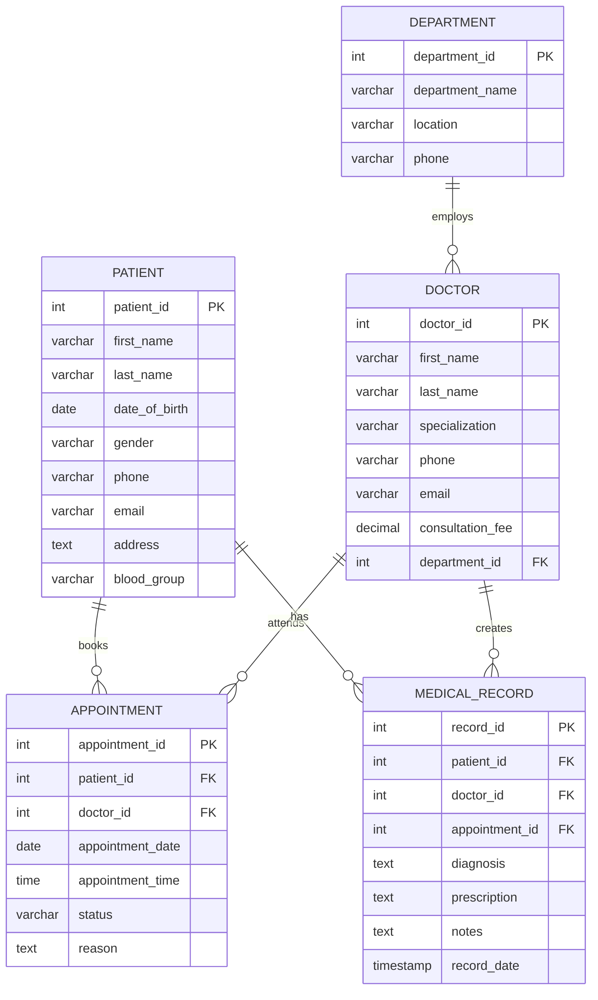

# Hospital Management System

A full-stack Hospital Management System designed to manage departments, doctors, patients, appointments, and medical records.

The application provides a web interface and RESTful backend APIs for performing core hospital management operations. It uses a MySQL database to manage relationships between hospital entities and maintain data integrity.

---

## Features

- Dashboard with hospital data overview
- Department management
- Doctor management
- Patient management
- Appointment scheduling and management
- Medical records management
- CRUD operations for core entities
- Appointment conflict prevention
- Data validation and database constraints
- Responsive user interface

---

## Tech Stack

| Layer | Technology |
|---|---|
| Frontend | HTML, CSS, JavaScript |
| Backend | Node.js, Express.js |
| Database | MySQL |
| Database Driver | mysql2 |
| Configuration | dotenv |

---

## System Architecture

```text
┌─────────────────────────────────────────────────────────────┐
│                         FRONTEND                            │
│              HTML • CSS • JavaScript                       │
│                                                             │
│      Dashboard • Forms • Tables • User Interface           │
└──────────────────────────┬──────────────────────────────────┘
                           │
                           │ HTTP Requests / JSON
                           ▼
┌─────────────────────────────────────────────────────────────┐
│                          BACKEND                            │
│                    Node.js • Express                       │
│                                                             │
│        REST APIs • Validation • Error Handling             │
└──────────────────────────┬──────────────────────────────────┘
                           │
                           │ SQL Queries
                           ▼
┌─────────────────────────────────────────────────────────────┐
│                         DATABASE                            │
│                           MySQL                             │
│                                                             │
│ Departments • Doctors • Patients • Appointments • Records  │
└─────────────────────────────────────────────────────────────┘
```

---

## Project Structure

```text
hospital-management-system/
│
├── frontend/
│   ├── index.html
│   ├── css/
│   │   └── style.css
│   └── js/
│       └── script.js
│
├── backend/
│   ├── server.js
│   ├── package.json
│   ├── .env.example
│   │
│   ├── config/
│   │   └── database.js
│   │
│   ├── middleware/
│   │   └── errorHandler.js
│   │
│   ├── routes/
│   │   ├── dashboard.js
│   │   ├── departments.js
│   │   ├── doctors.js
│   │   ├── patients.js
│   │   ├── appointments.js
│   │   └── medicalRecords.js
│   │
│   └── utils/
│       ├── asyncHandler.js
│       ├── errors.js
│       └── validation.js
│
├── database/
│   ├── hospital_management.sql
│   └── queries.sql
│
└── README.md
```

---

# Database Design

The system manages five main entities:

- Departments
- Doctors
- Patients
- Appointments
- Medical Records

## Entity-Relationship Diagram



### Relationships

- A department can have multiple doctors.
- A patient can have multiple appointments.
- A doctor can attend multiple appointments.
- A patient can have multiple medical records.
- A doctor can create multiple medical records.

---

## Database Concepts Used

- Relational Database Design
- Entity-Relationship Modeling
- Database Normalization
- Primary Keys
- Foreign Keys
- Unique Constraints
- Referential Integrity
- SQL Joins
- CRUD Operations
- Parameterized Queries

---

## Data Integrity

The database uses primary keys, foreign keys, and constraints to maintain consistency between related records.

The appointment system prevents a doctor from being booked for multiple appointments at the same date and time.

```sql
UNIQUE (doctor_id, appointment_date, appointment_time)
```

---

# Installation and Setup

## Prerequisites

Make sure you have the following installed:

- Node.js
- npm
- MySQL

Optional:

- MySQL Workbench
- Visual Studio Code

---

## 1. Clone the Repository

```bash
git clone https://github.com/NucLeYA-techi/hospital-management-system.git
cd hospital-management-system
```

---

## 2. Set Up the Database

Import the database script:

```text
database/hospital_management.sql
```

Or use the command line:

```bash
mysql -u root -p < database/hospital_management.sql
```

This creates the required database, tables, relationships, constraints, and sample data.

---

## 3. Configure Environment Variables

Navigate to the backend directory:

```bash
cd backend
```

Create a `.env` file:

```env
DB_HOST=localhost
DB_PORT=3306
DB_USER=root
DB_PASSWORD=your_mysql_password
DB_NAME=hospital_management
PORT=3000
```

---

## 4. Install Dependencies

```bash
npm install
```

---

## 5. Run the Application

```bash
npm start
```

Open the application in your browser:

```text
http://localhost:3000
```

For development:

```bash
npm run dev
```

---

# API Overview

Base URL:

```text
http://localhost:3000/api
```

| Method | Endpoint | Description |
|---|---|---|
| GET | `/health` | Check API and database connection |
| GET | `/dashboard` | Get dashboard data |
| GET / POST | `/departments` | Manage departments |
| GET / POST | `/doctors` | Manage doctors |
| GET / POST | `/patients` | Manage patients |
| GET / POST | `/appointments` | Manage appointments |
| GET / POST | `/medical-records` | Manage medical records |

Additional `PUT`, `PATCH`, and `DELETE` endpoints are available for updating and removing records.

---

# Example SQL Queries

### Appointment Details

```sql
SELECT
    a.appointment_id,
    a.appointment_date,
    a.appointment_time,
    a.status,
    CONCAT(p.first_name, ' ', p.last_name) AS patient_name,
    CONCAT(d.first_name, ' ', d.last_name) AS doctor_name
FROM appointment a
JOIN patient p ON a.patient_id = p.patient_id
JOIN doctor d ON a.doctor_id = d.doctor_id;
```

### Doctors in Each Department

```sql
SELECT
    dep.department_name,
    COUNT(d.doctor_id) AS doctor_count
FROM department dep
LEFT JOIN doctor d ON dep.department_id = d.department_id
GROUP BY dep.department_id, dep.department_name;
```

---

# Testing

After setting up the project, test the following:

1. Add a department.
2. Add a doctor and assign them to a department.
3. Add a patient.
4. Create an appointment.
5. Try creating a duplicate appointment for the same doctor and time.
6. Update an appointment status.
7. Add a medical record.
8. Test update and delete operations.

---

# Future Improvements

- User authentication
- Role-based access control
- Search and filtering
- Pagination
- Appointment notifications
- Analytics and reporting
- Billing management
- Pharmacy management

---

## License

This project is intended for educational and learning purposes.
